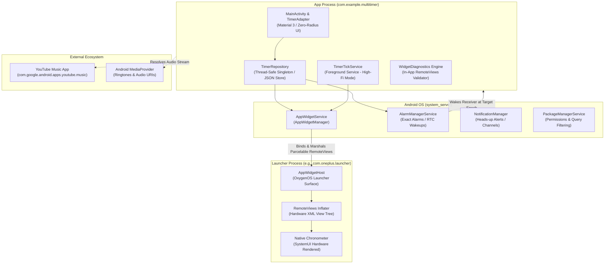
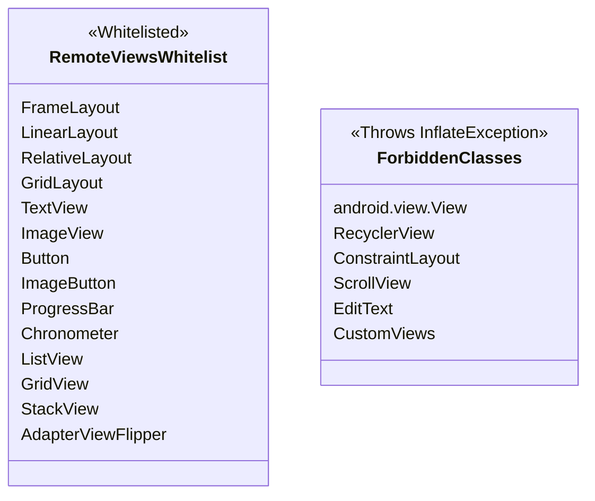
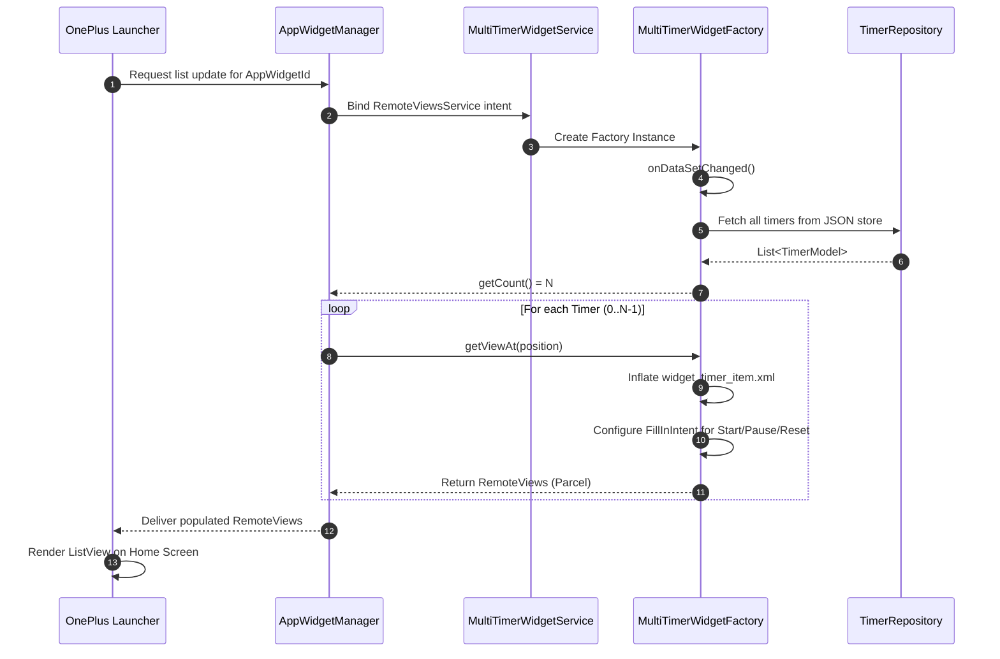
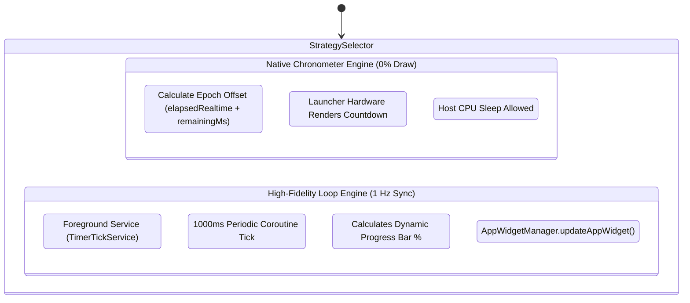
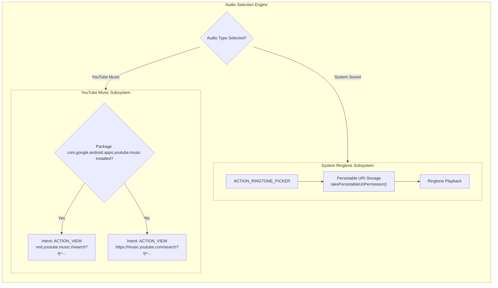
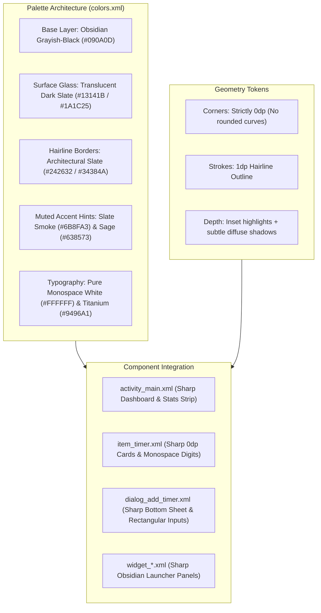
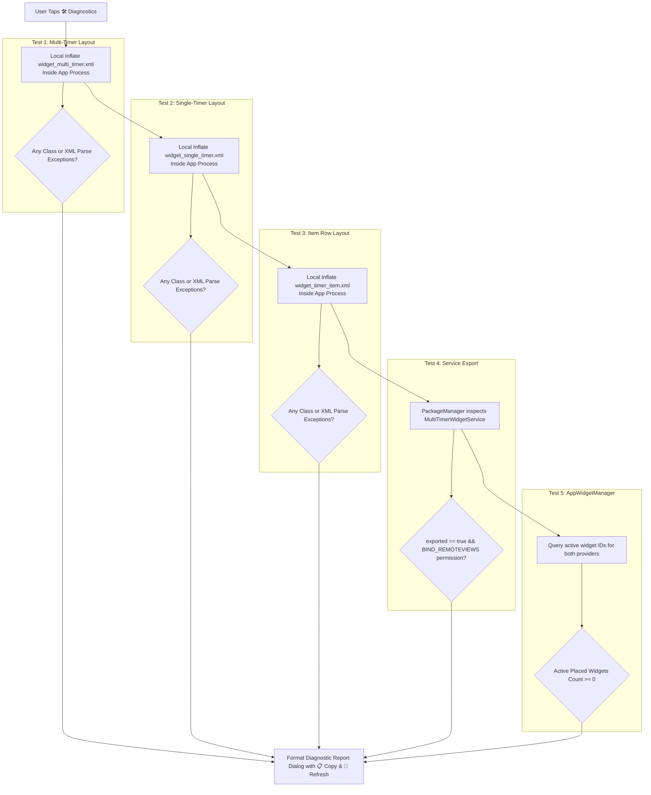
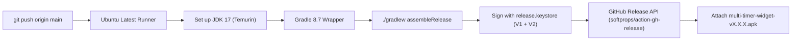

# Multi-Timer Widget: Comprehensive Technical Architecture & Deep Dive

This document provides an exhaustive, low-level architectural specification of the **Multi-Timer Widget** Android application and launcher subsystem. It explains the exact responsibilities of every library, class, component, and IPC protocol involved, illustrated with structured architectural graphics and sequence flows.

---

## 1. High-Level System Topology & Process Boundaries

Android Home Screen Widgets run in an entirely different process than standard applications. Understanding this boundary is critical to understanding how the entire system functions.



### Process Isolation Rules
1. **The Host Process (`com.example.multitimer`)**: Houses the application UI, business logic, persistence layer, and foreground tickers.
2. **The OS Kernel & System Server (`system_server`)**: Mediates cross-process communication through Android Binder RPCs (`AppWidgetService`, `AlarmManagerService`).
3. **The Launcher Process (`com.oneplus.launcher`)**: Renders the visual widget tree on the user's home screen. The host app **cannot directly manipulate views** on the launcher; it must compile declarative instructions (`RemoteViews`) and parcel them across the Binder boundary.

---

## 2. RemoteViews & Cross-Process Widget Architecture

### 2.1 The RemoteViews Whitelist & Inflation Protocol
A `RemoteViews` object is a declarative blueprint describing a view hierarchy that is rendered by an external process. The Android OS enforces a strict security and memory whitelist on permitted view classes.



#### Why Widgets Failed Previously (Root-Cause Deep Dive):
* **Forbidden `<View>` Divider Tag**: Generic `<View>` lacks the internal `@RemoteView` annotation. When OxygenOS launcher attempted to inflate `widget_multi_timer.xml` containing `<View android:layout_height="1dp" .../>`, the launcher's XML parser halted with:
  ```
  android.view.InflateException: Class not allowed to be inflated in RemoteViews: android.view.View
  ```
  **Fix Applied**: Replaced `<View>` dividers with `<FrameLayout>` containers (which are explicitly whitelisted).
* **Service Export Security**: The collection widget binds to `MultiTimerWidgetService` to render `ListView` items. When `android:exported="false"` was specified, the OnePlus launcher process was denied binding access by Android's security sandbox, throwing a silent `SecurityException`.
  **Fix Applied**: Configured `android:exported="true"` with `android.permission.BIND_REMOTEVIEWS`.

### 2.2 Remote Collection (ListView) Data Binding Flow



---

## 3. Dual Render Engines: Battery Strategy Deep Dive

To prevent the common pitfall of third-party Android timer widgets (which drain the device battery by waking the CPU every second), this architecture implements two distinct rendering strategies:



### 3.1 Strategy 1: Native SystemUI Chronometer (0% CPU Consumption)
* **Underlying Android Component**: `android.widget.Chronometer`
* **Mechanism**: The Android launcher host process internally hooks into hardware display refresh ticks. By supplying a calculated `base` timestamp, the countdown ticks natively on screen without requiring the host application process to remain awake or run a background loop.
* **Mathematical Base Calculation**:
  Android's Chronometer natively counts **up** from a base timestamp. To emulate an accurate **countdown**, the countdown base is calculated as:
  $$\text{Base} = \text{SystemClock.elapsedRealtime}() + \text{RemainingMs}$$
  Using the framework method:
  ```kotlin
  views.setChronometer(R.id.chronometer_view, baseTime, "%s", true) // countdown = true
  views.setChronometerCountDown(R.id.chronometer_view, true)
  ```

### 3.2 Strategy 2: High-Fidelity Loop (1 Hz Real-Time Synchronization)
* **Underlying Android Component**: `TimerTickService` (Foreground Service)
* **Mechanism**: When timers are running and high-fidelity mode is active, the app starts a foreground service declared with `android:foregroundServiceType="specialUse"`.
* **Execution**: A Kotlin Coroutine executes a periodic `delay(1000L)` loop that:
  1. Computes exact elapsed milliseconds:
     $$\text{Progress} = \left(\frac{\text{TotalMs} - \text{RemainingMs}}{\text{TotalMs}}\right) \times 100$$
  2. Updates the horizontal progress bar via `RemoteViews.setProgressBar()`.
  3. Formats exact MM:SS strings for high-definition text displays.

---

## 4. Exact Timing & Alarm Trigger Subsystem

When the device screen is turned off or enters Android Doze Mode, standard coroutine tickers and background tasks are suspended by the OS battery management system. The timer completion relies on hardware RTC alarms.

```mermaid
sequenceDiagram
    autonumber
    participant App as TimerRepository
    participant AM as AlarmManager
    participant Receiver as TimerAlarmReceiver
    participant NM as NotificationManager
    participant YTM as YouTube Music / Media

    App->>AM: setExactAndAllowWhileIdle(RTC_WAKEUP, triggerAtMillis, pendingIntent)
    Note over AM: Device enters deep Doze / CPU sleeps
    AM->>Receiver: onReceive(context, intent) [Target Epoch Reached]
    Receiver->>Receiver: Acquire Partial WakeLock
    Receiver->>NM: Build Heads-Up FullScreen Notification
    alt Is YouTube Music Timer
        Receiver->>YTM: Launch Deep-Link Intent (vnd.youtube.music:// or Web Search)
    alt Is System Ringtone
        Receiver->>MediaProv: Play RingtoneManager audio stream
    end
    Receiver->>App: Mark Timer as FINISHED & notifyWidgets()
```

### Critical OS Permissions Used
* `android.permission.SCHEDULE_EXACT_ALARM`: Ensures the alarm fires within milliseconds of the target epoch, even in Doze Mode.
* `android.permission.USE_FULL_SCREEN_INTENT`: Enables the timer to pop up as a priority heads-up alert over the lock screen.
* `android.permission.POST_NOTIFICATIONS`: Complies with Android 13+ (API 33+) runtime notification requirements.

---

## 5. Audio & Media Routing Architecture

The application supports dual audio architectures: system notification audio and deep-linked YouTube Music tracks.



### YouTube Music Query Manifest Filter
Android 11+ restricts package discovery unless explicitly declared. The manifest includes:
```xml
<queries>
    <package android:name="com.google.android.apps.youtube.music" />
</queries>
```
This enables the app to inspect whether the native YouTube Music client is installed on the user's OnePlus device and dispatch the native application intent directly.

---

## 6. Zero-Radius Frosted Glass Design System

The visual architecture is implemented as an architectural, high-contrast, zero-radius frosted glass design system.



### Visual Specifications
| Token | Hex / Spec | Role in Design |
|---|---|---|
| `bg_dark` | `#090A0D` | Obsidian background base, non-reflective |
| `surface_card` | `#13141B` | Primary frosted glass card layer |
| `surface_card_inner` | `#1A1C25` | Recessed tactile button and input container |
| `surface_card_stroke_bright` | `#34384A` | Hairline border stroke defining card boundaries |
| `primary` | `#6B8FA3` | Muted slate smoke for subtle progress highlights |
| `accent` | `#638573` | Muted sage green indicating running timers |
| `warning` | `#947D60` | Muted warm taupe for paused timers |
| `danger` | `#8F5A62` | Muted wine red for finished timers |
| `text_main` | `#FFFFFF` | Monospace high-legibility digits and headers |

---

## 7. In-App Widget Diagnostics Test Harness

Because Android OEM launchers (such as OxygenOS Launcher) suppress RemoteViews inflation exceptions and only display a generic card (`"Problem loading widget"`), the app embeds a real-time diagnostics engine ([`WidgetDiagnostics.kt`](file:///D:/upskilling/agy/multi-timer-widget/app/src/main/java/com/example/multitimer/util/WidgetDiagnostics.kt)).



---

## 8. Continuous Integration & Delivery Pipeline

Releases are built, signed, and published automatically on every push via GitHub Actions.



### Release History & Milestones
* **v1.0.5**: Added YouTube Music per-timer deep linking, heads-up notifications, and preset chips.
* **v1.0.6**: Resolved OnePlus launcher crashes by converting `<View>` tags to `<FrameLayout>`, exporting `MultiTimerWidgetService`, and adding the in-app Diagnostics Inspector.
* **v1.0.7**: Upgraded to 2026 Material 3 Glassmorphism with executive stats bar and redesigned app icon.
* **v1.0.8**: Implemented the **Zero-Radius Sharp Frosted Glass** design system with grayish-black palette and subtle muted hints.
